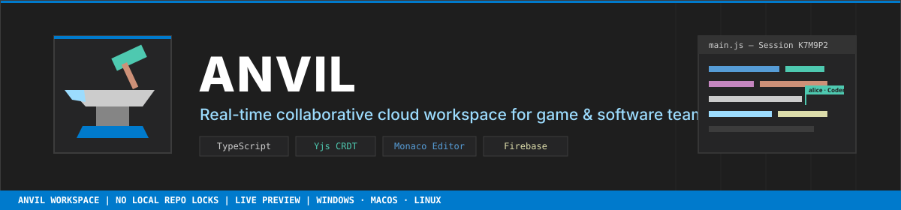
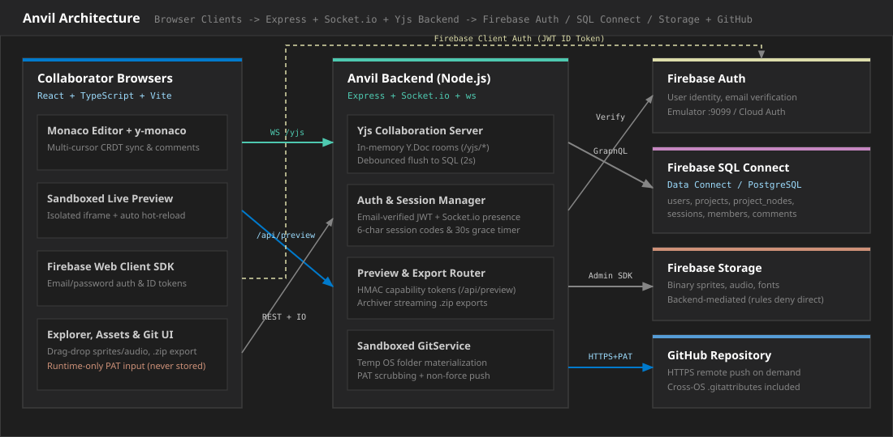
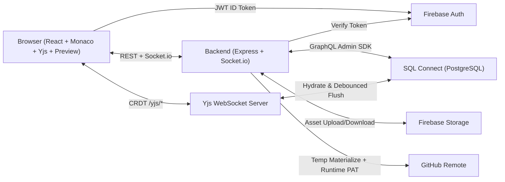
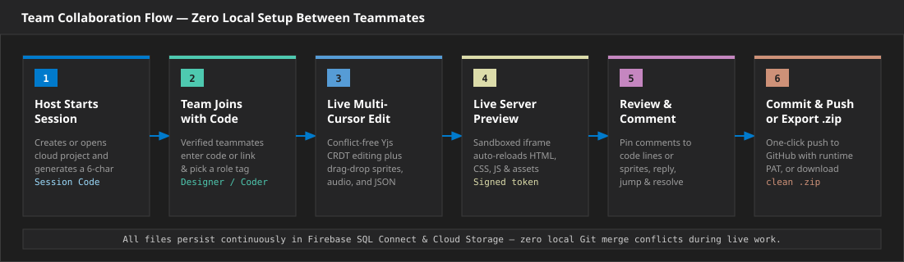
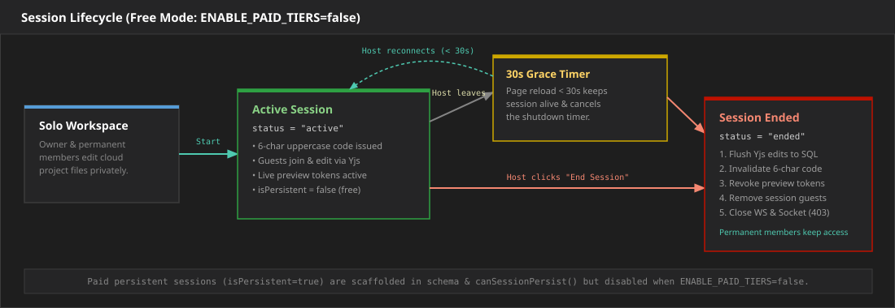
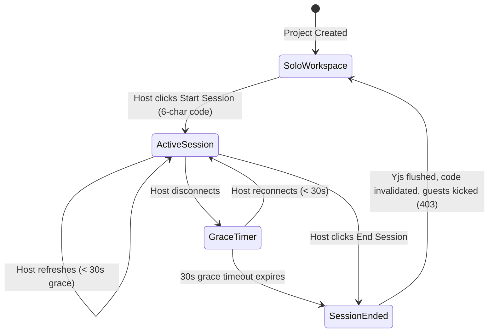
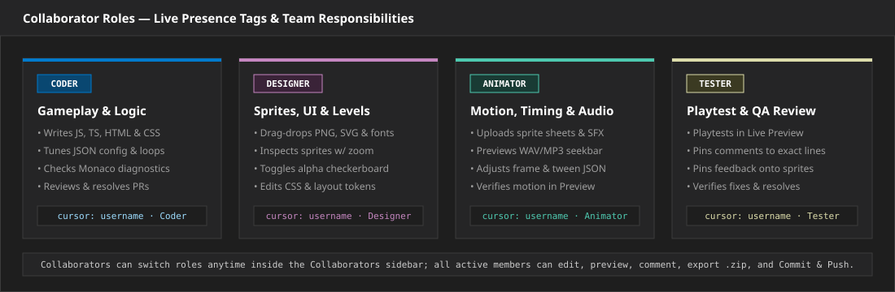

<p align="center">
  
</p>

<p align="center">
  <a href="https://github.com/YOUR_USERNAME/anvil/actions/workflows/ci.yml"></a>
  <a href="LICENSE"></a>
  
  
  
  
</p>

**Anvil** is a browser-based, real-time collaborative IDE and cloud project workspace styled after Visual Studio Code (Dark+). Coders, designers, animators, and testers work together simultaneously inside one shared cloud project—editing code with live multi-cursors, previewing sprites and audio, testing builds in a sandboxed Live Server pane, pinning feedback comments, and pushing snapshots straight to GitHub without local repositories or file locks.

---

## Why Anvil?

Traditional game and web collaboration forces designers, animators, and testers to install Git, manage branch conflicts, resolve line-ending mismatches across Windows/macOS/Linux, and sync binary assets just to tweak a level config or test a sprite change.

**Anvil** removes local repository friction during active teamwork:

- **Zero local setup for teammates:** Join an active workspace in the browser with a 6-character session code.
- **No file locks or merge conflicts:** Yjs CRDTs merge simultaneous keystrokes across editors automatically.
- **Unified workspace for every discipline:** Code, sprites, audio, fonts, live preview, and review comments live side by side.
- **Cross-OS safety built in:** Enforces Windows reserved-name checks, macOS NFC Unicode normalization, and case-insensitive sibling rules so `.zip` exports and GitHub pushes work identically on Windows, macOS, and Linux.

---

## Features

- **[Cloud Project Folder]** All text files and metadata persist in Firebase SQL Connect (PostgreSQL), and binary assets (`PNG`, `SVG`, `JPG`, `GIF`, `WEBP`, `ICO`, `WAV`, `MP3`, `OGG`, `WOFF`, `WOFF2`, `TTF`, `OTF`) store in Firebase Storage with drag-and-drop uploads and built-in Sprite/Audio/Font previewers.
- **[Real-Time Multi-Cursor Editing]** Monaco Editor paired with Yjs (`y-monaco` + `y-websocket`) displays live colored cursors and selections tagged with `"username · Role"`.
- **[Live Server Preview]** Sandboxed `<iframe>` previewer auto-reloads whenever code or assets change and supports switching entry HTML files or opening in a new tab.
- **[Team Roles]** Teammates select and switch roles (`Coder`, `Designer`, `Animator`, `Tester`) shown in live cursors and the Collaborators sidebar.
- **[Pinned Comments]** Pin comment threads directly to code lines (with Monaco gutter markers and click-to-jump) or binary assets, reply live, and mark threads Resolved/Reopened.
- **[One-Click Commit & Push]** Any authorized project member can push the current cloud workspace snapshot directly to GitHub over HTTPS with streaming logs and non-force-push safety.
- **[Cross-OS .zip Export]** Stream the entire cloud directory tree and binary assets into a clean `.zip` archive compatible with Windows Explorer, macOS Archive Utility, and Linux `unzip`.
- **[6-Character Session Codes]** Hosts start live sessions with shareable 6-character codes or `?session=CODE` URLs; ending the session or disconnecting past the 30s grace timer invalidates the code and revokes temporary guest access.
- **[Email-Verified Accounts]** Firebase Auth registration enforces unique case-insensitive usernames and email verification before creating or joining projects.

---

## Visual Walkthrough & Architecture

### System Architecture





### Team Collaboration Flow



### Session Lifecycle





### Collaborator Roles



---

## Screenshots

> **Note for Maintainer (Tarun):** Capture real screenshots from your running local instance (`npm run dev` + `npm run seed`), save them inside [`docs/screenshots/`](docs/screenshots/README.md) using the exact filenames below, and verify no real personal emails, tokens, or secrets appear in the captures.

| Screen                        | File Path                           | What It Shows                                                             |
| ----------------------------- | ----------------------------------- | ------------------------------------------------------------------------- |
| Login & Email Verification    | `docs/screenshots/login.png`        |                |
| Cloud Explorer & Asset Viewer | `docs/screenshots/explorer.png`     |          |
| Live Multi-Cursor Editing     | `docs/screenshots/live-editing.png` |  |
| Sandboxed Live Preview        | `docs/screenshots/preview.png`      |            |
| Pinned Comments & Threads     | `docs/screenshots/comments.png`     |          |
| GitHub Commit & Push Panel    | `docs/screenshots/git-panel.png`    |        |

---

## Tech Stack

| Layer                         | Technologies                                                                                                     |
| ----------------------------- | ---------------------------------------------------------------------------------------------------------------- |
| **Frontend**                  | React 18, TypeScript, Vite 6, Tailwind CSS 4, Monaco Editor (`@monaco-editor/react`), Lucide Icons               |
| **Real-Time Collaboration**   | Yjs, `y-monaco`, `y-websocket`, `y-protocols`, Socket.io Client                                                  |
| **Backend**                   | Node.js LTS, Express 4, Socket.io 4, `ws`, Zod, Helmet, `express-rate-limit`, Multer, Archiver                   |
| **Database & Auth & Storage** | Firebase Authentication, Firebase Data Connect (SQL Connect / PostgreSQL + PGlite emulator), Firebase Storage    |
| **DevSecOps & Quality**       | Gitleaks (`.gitleaks.toml` + `.githooks/pre-commit`), GitHub Actions CI, ESLint 9, Prettier, Vitest, `node:test` |

---

## Getting Started

### Prerequisites (All Platforms)

1. **Node.js LTS** (`v20`, `v22`, or `v24` — `.nvmrc` pins `22`) and `npm`
2. **Git** (`>= 2.30`)
3. **Java JDK 21+** (required by Firebase CLI `15.x` Local Emulator Suite)
4. **Firebase CLI** (included in `devDependencies`, or install globally with `npm install -g firebase-tools`)
5. **Gitleaks** (recommended for local pre-commit secret scanning)

Detailed per-OS install guides:

- [Windows Setup Guide](docs/setup-windows.md)
- [macOS Setup Guide](docs/setup-macos.md)
- [Linux Setup Guide](docs/setup-linux.md)

### 1. Clone and Copy Environment Templates

**Windows (PowerShell):**

```powershell
git clone https://github.com/YOUR_USERNAME/anvil.git
cd anvil
Copy-Item .env.example .env
Copy-Item .firebaserc.example .firebaserc
```

**macOS & Linux:**

```bash
git clone https://github.com/YOUR_USERNAME/anvil.git
cd anvil
cp .env.example .env
cp .firebaserc.example .firebaserc
```

_(The default values in `.env.example` are preconfigured to work out-of-the-box with local Firebase Emulators.)_

### 2. Install Dependencies

```bash
npm install
```

### 3. Start Emulators and App

Start Firebase Emulators (Auth, Storage, Data Connect), the Express/Yjs backend, and the Vite frontend together:

```bash
npm run dev
```

Once the emulators report ready, open a second terminal in the repository root and seed the sample accounts and playable **Space Dodge** starter project:

```bash
npm run seed
```

Seeded local emulator accounts:

- **User 1 (Host / Owner):** `alice@anvil.local` / `AnvilTest!123`
- **User 2 (Member):** `bob@anvil.local` / `AnvilTest!123`

### 4. Test Two Users Live (Two Browser Windows)

1. Open **Window A** (`http://localhost:5173`) and sign in as `alice@anvil.local` (`AnvilTest!123`) — or register a new account and open the verification link from the Firebase Emulator UI at `http://127.0.0.1:4000/auth`.
2. Open **Window B** in an **Incognito / Private** window (`http://localhost:5173`) and sign in as `bob@anvil.local` (`AnvilTest!123`).
3. In **Window A**, open **Space Dodge** and click **Start Session** to get the 6-character **Session Code**.
4. In **Window B**, enter the **Session Code**, pick a role (`Designer`, `Animator`, `Tester`, or `Coder`), and click **Join Session**.
5. Edit `main.js` or `style.css` simultaneously in both windows to see multi-cursor labels, Live Preview auto-reloads, pinned comment threads, and `.zip` export.

### 5. Run Tests, Lint & Build

```bash
npm run lint
npm run typecheck
npm test
npm run build
npm run secrets:scan
```

To run the full end-to-end integration test against real Firebase Emulators:

```bash
npm run test:e2e
```

---

## Environment Variables

All environment variables are configured in a single root `.env` file (copied from [`.env.example`](.env.example)). Both backend and frontend validate required variables at startup and fail fast with clear error messages if any are missing.

| Variable                                  | Required     | Scope    | Description                                                     | Example Placeholder                                       |
| ----------------------------------------- | ------------ | -------- | --------------------------------------------------------------- | --------------------------------------------------------- |
| `NODE_ENV`                                | Optional     | Backend  | Runtime environment (`development`, `test`, `production`)       | `development`                                             |
| `PORT`                                    | Optional     | Backend  | HTTP/WebSocket server port (default `4001`)                     | `4001`                                                    |
| `FRONTEND_ORIGIN`                         | Optional     | Backend  | Allowed frontend origin for CORS and preview CSP                | `http://localhost:5173`                                   |
| `FIREBASE_PROJECT_ID`                     | **Required** | Backend  | Firebase project ID (use `demo-*` for offline emulators)        | `demo-anvil`                                              |
| `FIREBASE_STORAGE_BUCKET`                 | **Required** | Backend  | Firebase Storage bucket name                                    | `demo-anvil.firebasestorage.app`                          |
| `USE_FIREBASE_EMULATORS`                  | Optional     | Backend  | `"true"` to connect backend SDKs to local emulators             | `true`                                                    |
| `FIREBASE_AUTH_EMULATOR_HOST`             | Conditional  | Backend  | Required when `USE_FIREBASE_EMULATORS=true`                     | `127.0.0.1:9099`                                          |
| `FIREBASE_STORAGE_EMULATOR_HOST`          | Conditional  | Backend  | Required when `USE_FIREBASE_EMULATORS=true`                     | `127.0.0.1:9199`                                          |
| `DATA_CONNECT_EMULATOR_HOST`              | Conditional  | Backend  | Required when `USE_FIREBASE_EMULATORS=true`                     | `127.0.0.1:9399`                                          |
| `DATA_CONNECT_SERVICE_ID`                 | Optional     | Backend  | Data Connect service ID (matches `dataconnect.yaml`)            | `anvil-dataconnect`                                       |
| `DATA_CONNECT_LOCATION`                   | Optional     | Backend  | Data Connect region                                             | `us-central1`                                             |
| `DATA_CONNECT_CONNECTOR`                  | Optional     | Backend  | Data Connect connector ID (matches `connector.yaml`)            | `anvil-connector`                                         |
| `GOOGLE_APPLICATION_CREDENTIALS`          | Conditional  | Backend  | Path to service account JSON (prod outside GCP)                 | `""`                                                      |
| `FIREBASE_SERVICE_ACCOUNT_JSON`           | Conditional  | Backend  | Inline service account JSON string (prod PaaS alternative)      | `""`                                                      |
| `SESSION_HOST_GRACE_MS`                   | Optional     | Backend  | Milliseconds before host disconnect ends non-persistent session | `30000`                                                   |
| `ENABLE_PAID_TIERS`                       | Optional     | Backend  | Scaffolded paid tier toggle (`false` = free mode only)          | `false`                                                   |
| `ADMIN_EMAILS`                            | Optional     | Backend  | Comma-separated admin account emails (kept server-side only)    | `""`                                                      |
| `YJS_SAVE_DEBOUNCE_MS`                    | Optional     | Backend  | Debounce delay (ms) before flushing Yjs docs to SQL             | `2000`                                                    |
| `PREVIEW_TOKEN_SECRET`                    | **Required** | Backend  | HMAC secret (`>= 16` chars) for Live Preview capability tokens  | `replace-with-random-32-char-secret-change-in-production` |
| `FIREBASE_WEB_API_KEY`                    | Optional     | Backend  | Server-side Firebase Web API key fallback for password login    | `""`                                                      |
| `MAX_UPLOAD_SIZE_MB`                      | Optional     | Backend  | Max file upload size in megabytes (1–100)                       | `15`                                                      |
| `GIT_TIMEOUT_MS`                          | Optional     | Backend  | Subprocess timeout (ms) for Git Commit & Push                   | `60000`                                                   |
| `VITE_API_URL`                            | Optional     | Frontend | Backend REST base URL (empty uses Vite proxy / same origin)     | `http://localhost:4001`                                   |
| `VITE_WS_URL`                             | Optional     | Frontend | Backend WebSocket base URL for `/yjs`                           | `ws://localhost:4001`                                     |
| `VITE_USE_EMULATORS`                      | Optional     | Frontend | `"true"` to point browser Firebase SDK to local emulators       | `true`                                                    |
| `VITE_FIREBASE_API_KEY`                   | **Required** | Frontend | Firebase Web App API key (public project identifier)            | `your-firebase-web-api-key`                               |
| `VITE_FIREBASE_AUTH_DOMAIN`               | **Required** | Frontend | Firebase Web Auth domain                                        | `demo-anvil.firebaseapp.com`                              |
| `VITE_FIREBASE_PROJECT_ID`                | **Required** | Frontend | Firebase Web project ID                                         | `demo-anvil`                                              |
| `VITE_FIREBASE_STORAGE_BUCKET`            | **Required** | Frontend | Firebase Web Storage bucket                                     | `demo-anvil.firebasestorage.app`                          |
| `VITE_FIREBASE_APP_ID`                    | **Required** | Frontend | Firebase Web App ID                                             | `your-firebase-web-app-id`                                |
| `VITE_FIREBASE_AUTH_EMULATOR_URL`         | Conditional  | Frontend | Required when `VITE_USE_EMULATORS=true`                         | `http://127.0.0.1:9099`                                   |
| `VITE_FIREBASE_STORAGE_EMULATOR_HOST`     | Conditional  | Frontend | Required when `VITE_USE_EMULATORS=true`                         | `127.0.0.1`                                               |
| `VITE_FIREBASE_STORAGE_EMULATOR_PORT`     | Conditional  | Frontend | Required when `VITE_USE_EMULATORS=true`                         | `9199`                                                    |
| `VITE_FIREBASE_DATACONNECT_EMULATOR_HOST` | Optional     | Frontend | Local Data Connect emulator host reference                      | `127.0.0.1`                                               |
| `VITE_FIREBASE_DATACONNECT_EMULATOR_PORT` | Optional     | Frontend | Local Data Connect emulator port reference                      | `9399`                                                    |

---

## Project Structure

```text
anvil/
├── .env.example                 # Documented environment variable template
├── .firebaserc.example          # Example Firebase CLI project alias template
├── .gitleaks.toml               # Secret scanner rules and safe test/template allowlists
├── .githooks/pre-commit         # Cross-platform Git pre-commit hook entry point (Node)
├── .github/                     # CI workflow (Gitleaks + Win/Mac/Linux matrix), templates, Dependabot
├── appConfig.ts                 # Single source of truth for app name, version, and team roles
├── firebase.json                # Firebase Local Emulator Suite configuration
├── storage.rules                # Firebase Storage rules (direct client access denied)
├── dataconnect/                 # Firebase SQL Connect schema & server-only GraphQL connectors
├── scripts/                     # Cross-platform Node scripts (emulator runner, pre-commit, secret scan)
├── docs/                        # Architecture, per-OS setup guides, security model, roadmap, SVGs
├── backend/                     # Node.js + Express + Socket.io + Yjs + Sandboxed Git API
│   ├── src/config/              # Zod fail-fast env validation & Firebase Admin SDK setup
│   ├── src/middleware/          # Firebase ID token verification & project/session access control
│   ├── src/routes/              # REST endpoints (auth, projects, sessions, comments, preview)
│   ├── src/services/            # Data Connect DB, Yjs CRDT server, SessionManager, GitService, ZipExport
│   ├── src/utils/filenames.ts   # Cross-OS Windows/macOS/Linux filename & path traversal rules
│   ├── scripts/e2eEmulators.ts  # Full end-to-end integration test against Firebase Emulators
│   └── tests/                   # Backend unit tests (node:test)
└── frontend/                    # React + TypeScript + Vite + Monaco + Yjs workbench UI
    ├── src/config/firebase.ts   # Firebase Web SDK initialization with fail-fast env checks
    ├── src/components/          # AuthGate, Lobby, Workspace, Explorer, Editor, Preview, Comments, Git
    ├── src/services/api.ts      # Authenticated REST & binary blob API client
    └── tests/                   # Frontend unit tests (Vitest)
```

---

## Security

- **Firebase Web Config vs. Server Credentials:** Firebase Web client values (`VITE_FIREBASE_*`) identify your Firebase project in the browser and are **not true secrets**—security is enforced by Firebase Auth and backend authorization—yet they are kept in `.env` so each deployment stays isolated. True server credentials (`service-account.json`, `FIREBASE_SERVICE_ACCOUNT_JSON`, `GOOGLE_APPLICATION_CREDENTIALS`, `PREVIEW_TOKEN_SECRET`, private keys) must **never** be committed or exposed with a `VITE_` prefix.
- **GitHub PAT Handling:** The GitHub Personal Access Token used by **Commit & Push** is entered by each collaborator at runtime, kept strictly in volatile memory for the duration of the push, scrubbed from logs/errors, and never written to SQL, disk, or browser storage.
- **What Must Never Be Committed:** `.env`, `.env.*` (except `.env.example`), `.firebaserc`, `service-account*.json`, `*-adminsdk-*.json`, `*.pem`, `*.key`, `.runtimeconfig.json`, or local emulator databases (`dataconnect/.dataconnect/pgliteData/`).
- **Reporting Vulnerabilities:** See [SECURITY.md](SECURITY.md) and [docs/security.md](docs/security.md).

---

## Roadmap

- Future paid persistent 24/7 sessions (`ENABLE_PAID_TIERS=false`, `plan_tier`, `is_persistent`) are scaffolded in the SQL Connect schema and backend (`canSessionPersist()`) but currently **disabled** (free mode only).
- See [docs/roadmap.md](docs/roadmap.md) for planned open-source milestones.

## Contributing

Contributions are welcome! Please read [CONTRIBUTING.md](CONTRIBUTING.md) and our [Code of Conduct](CODE_OF_CONDUCT.md) before opening a pull request.

## License

Licensed under the [MIT License](LICENSE).

## Acknowledgements

Built with [Monaco Editor](https://microsoft.github.io/monaco-editor/), [Yjs](https://docs.yjs.dev/), [Socket.io](https://socket.io/), [Express](https://expressjs.com/), [React](https://react.dev/), [Tailwind CSS](https://tailwindcss.com/), and [Firebase](https://firebase.google.com/).
# Anvil
