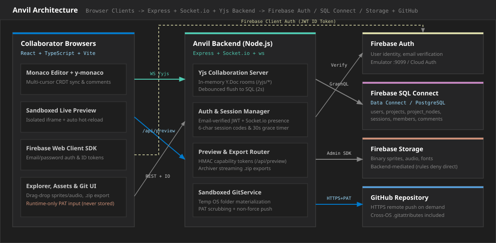
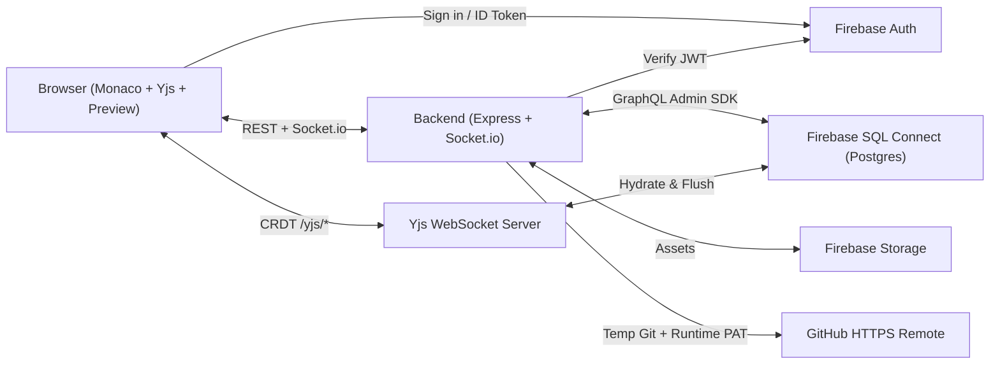

# Anvil Architecture

Anvil is a browser-based collaborative IDE and cloud project workspace. Instead of asking every teammate to clone Git repositories or manage local file locks, Anvil stores project files in **Firebase SQL Connect (Data Connect / PostgreSQL)** and binary assets in **Firebase Storage**, while mediating all real-time editing, live previews, and Git pushes through a **Node.js + Express + Socket.io + Yjs** backend.

## Core Components

### 1. Frontend Workbench (`frontend/`)

- **React + TypeScript + Vite + Tailwind CSS** styled in a sharp VS Code Dark+ layout.
- **Monaco Editor + `y-monaco` + `y-websocket`**: Streams conflict-free CRDT edits and per-user awareness cursors (`username · Role`) over `/yjs/<projectId>:<nodeId>`.
- **Asset & Sprite Viewer**: Previews `PNG`, `SVG`, `JPG`, `GIF`, `WEBP`, `ICO` (zoom controls and alpha checkerboard), `WAV`/`MP3`/`OGG` audio (seekbar and mute), and `WOFF`/`WOFF2`/`TTF`/`OTF` fonts.
- **Sandboxed Live Preview**: Renders `index.html` (or any chosen `.html` entry file) in `<iframe sandbox="allow-scripts allow-forms allow-modals">` using a short-lived signed capability token.

### 2. Backend Services (`backend/`)

- **Zod Environment Validation (`src/config/env.ts`)**: Fails fast on startup if required project IDs, emulator bindings, or `PREVIEW_TOKEN_SECRET` are missing or insecure.
- **Authentication & Access Control (`src/middleware/`)**:
  - Verifies Firebase ID tokens on REST routes, Socket.io handshakes, and Yjs WebSocket upgrades.
  - Enforces `email_verified === true` and registered SQL profile (`requireVerifiedUser`).
  - Enforces project ownership, permanent membership, or active session participation (`assertProjectAccess`).
- **Yjs Collaboration Server (`src/services/yjsServer.ts`)**:
  - Hydrates in-memory `Y.Doc` rooms from PostgreSQL (`project_nodes.content_text`) before completing the WebSocket 101 upgrade.
  - Debounces saves (`YJS_SAVE_DEBOUNCE_MS`, default `2000ms`) back to SQL and notifies `SessionManager` to trigger Live Preview hot-reloads.
- **Session Manager (`src/services/sessionManager.ts`)**:
  - Generates 6-character uppercase session codes (`ABCDEFGHJKLMNPQRSTUVWXYZ23456789`).
  - Tracks live presence (`activeNodeId`, `activeFilePath`, role, cursor color).
  - Starts a 30-second host grace timer (`SESSION_HOST_GRACE_MS`) when the host disconnects; if the host refreshes within 30s the timer is cancelled, otherwise the session ends, temporary guests are disconnected (`403`), and preview capability tokens are revoked.
- **Sandboxed Git Service (`src/services/gitService.ts`)**:
  - Flushes pending Yjs edits to SQL, materializes cloud files into a unique OS temp folder (`anvil-git-*`), enforces `core.autocrlf false` and `core.fileMode false`, writes `.gitattributes` if absent, commits as the pushing user, and pushes over HTTPS without force-pushing.
  - Scrubs the user's runtime PAT from all stdout, stderr, and thrown errors before streaming logs.
- **Cross-OS Filename Safety (`src/utils/filenames.ts`)**:
  - Normalizes Unicode to `NFC` (preventing macOS NFD vs Linux/Windows NFC mismatches).
  - Enforces case-insensitive sibling uniqueness (`unique_sibling_key` in SQL).
  - Rejects Windows reserved names (`CON`, `PRN`, `AUX`, `NUL`, `COM1-9`, `LPT1-9`), illegal characters, trailing spaces/dots, and `..` path traversal.

### 3. Firebase Data Layer (`dataconnect/` & `storage.rules`)

- **Firebase Auth**: User accounts, passwords, and email verification links.
- **Firebase SQL Connect (PostgreSQL)**: Tables `users`, `projects`, `project_members`, `project_nodes`, `sessions`, `session_members`, and `comments` — all Data Connect operations use `@auth(level: NO_ACCESS)` so clients never bypass backend authorization.
- **Firebase Storage**: Binary sprites, audio, and fonts under `projects/{projectId}/assets/{nodeId}/{filename}`; `storage.rules` sets `allow read, write: if false;` so only the authenticated backend can access assets.

